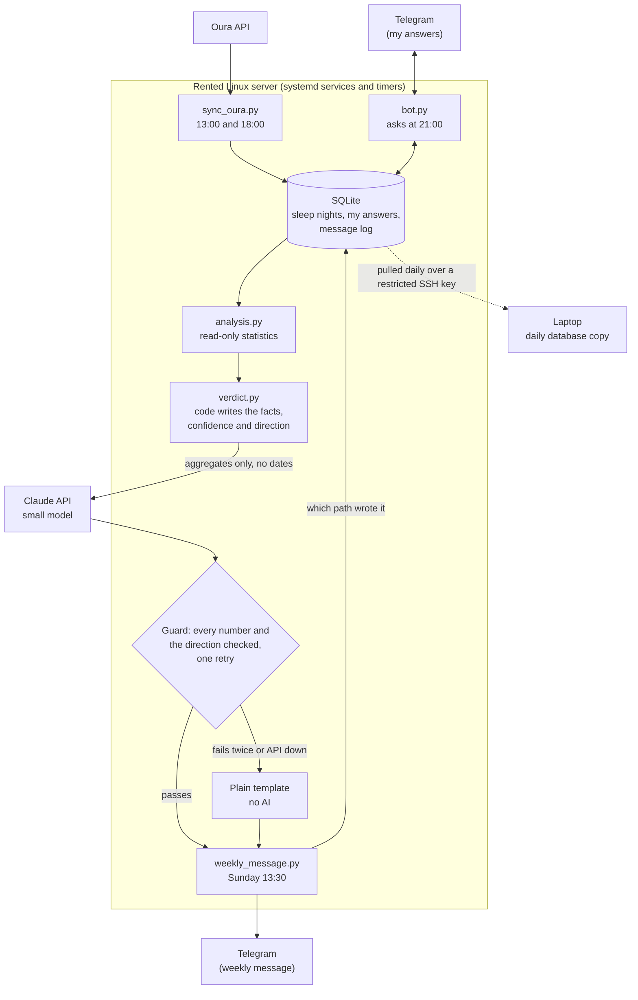

# oura-caffeine

**Does caffeine after 5pm change how I sleep?** A personal data project: a Telegram bot, an Oura Ring sync, and a weekly report in which the code states the facts and an AI model only explains them.

## What it does and why

Every evening a Telegram bot asks me one question (did I have caffeine after 5pm?), and a sync pulls my sleep data from the Oura Ring API into a small database. Once a week it compares the nights with caffeine against the nights without and sends me a short message saying what the numbers do and, just as importantly, do not show. I built it to practise careful analysis on small, messy, personal data, and to work out where an AI model is safe to put in the loop (explaining) and where it is not (stating facts and certainty).

## How this was built

I built it with Claude Code as the coding agent. I made the product and design decisions, reviewed each step, and caught and corrected mistakes along the way. [DECISIONS.md](DECISIONS.md) is the record of those decisions. A few examples of where my review changed the result:

- I checked the agent's reports about my system rather than trusting them, after one turned out to be wrong ([decision 3](DECISIONS.md#3-verify-what-the-coding-agent-says-not-just-what-it-builds)).
- I set the rules the analysis must follow, such as a confidence interval that has to exclude zero before a result is called a finding ([decision 12](DECISIONS.md#12-weekly-analysis-how-caffeine-nights-are-compared-and-how-sure-the-label-is-allowed-to-sound)).
- I chose habit tracking over a randomised experiment, knowing it makes the data accumulate slowly ([decision 14](DECISIONS.md#14-habit-tracking-first-the-caffeine-comparison-fills-slowly-from-the-evenings-i-slip)).

## Architecture



## How a week works

| When (Prague time) | What happens |
|---|---|
| Every evening, 21:00 | The bot asks "caffeine after 5pm?" with buttons, then "anything unusual?" (alcohol, illness, travel, other, nothing). A catch-up check every 10 minutes covers a late start; after midnight the evening is skipped, never asked late. |
| Daily, 13:00 and 18:00 | The sync refreshes the last 30 days of Oura nights. Re-running is safe. Oura labels a night with the date I wake up, so evening *D* is paired with night *D+1*. |
| Daily, 14:00 | My laptop pulls a checked copy of the database (30 copies kept). |
| Sunday, 13:30 | `analysis.py` compares nights with and without caffeine; `verdict.py` builds the message; it is sent to my chat and the path that wrote it is logged. |

What the Sunday message looks like (made-up numbers):

```
Last 7 evenings: kept the 5pm rule on 5 of 6 answered evenings; 1 unanswered.

Confidence: HINT (sleep score, answers given on the evening only): a first look only; a group has too few nights to say more.

Sleep score was 6 points lower on nights with caffeine after 5pm, which is worse. The 95% range for the gap runs from 15 points lower to 3 points higher, so no difference at all cannot be ruled out. Based on 3 nights with caffeine after 5pm and 11 without.
Lowest heart rate (secondary): 2 bpm higher on nights with caffeine, which is worse (hint).

This is only a first look, and more nights would help. This shows a link, not a cause, and a steady trend in your health over time could be mistaken for a caffeine effect.

(Explanation written by AI; its numbers are checked against the data.)
```

Everything above the last paragraph is written by code straight from the data. Only the short explanation comes from the AI.

## Design decisions worth reading

Each links to the reasoning in [DECISIONS.md](DECISIONS.md), written at the time with the trade-offs.

- **The code owns the facts; the AI owns the explanation.** The confidence label, the main result, its direction and its range are built by code, so the AI can never make a result sound firmer or flip better and worse. [Decision 13](DECISIONS.md#13-the-weekly-message-the-code-states-the-result-the-ai-only-explains-and-every-number-is-checked)
- **A number and direction guard, with a plain fallback.** Every number in the AI's text must trace to the data under a stated rounding rule, and it is rejected if it says the opposite of the code's direction. One retry, then a template built without AI, so a correct message always arrives. [Decision 13](DECISIONS.md#13-the-weekly-message-the-code-states-the-result-the-ai-only-explains-and-every-number-is-checked)
- **Unanswered never means "no".** A missing answer is stored explicitly and left out of the comparison, so unknown evenings cannot dilute the "no caffeine" group. [Decision 5](DECISIONS.md#5-date-alignment-and-the-two-table-design) and [decision 7](DECISIONS.md#7-telegram-bot-dates-come-from-the-question-and-only-my-chat-is-accepted)
- **Evening-to-night date alignment.** An off-by-one date would pair every answer with the wrong night and still produce clean-looking numbers. The pairing rule lives in exactly one place, a database view. [Decision 5](DECISIONS.md#5-date-alignment-and-the-two-table-design)
- **Single-use token handling.** Oura refresh tokens work once, so a lost one means logging in again. Tokens are saved before use, written atomically and guarded by a lock, and only one machine may hold a live one. [Decision 2](DECISIONS.md#2-how-oura-tokens-are-stored) and [decision 9](DECISIONS.md#9-the-project-moves-from-my-laptop-to-a-rented-server-in-canada)
- **Habit tracking over a randomised experiment.** I chose to keep the habit rather than flip a coin for caffeine evenings, so the comparison fills slowly and stays an association. The code is built to say so. [Decision 14](DECISIONS.md#14-habit-tracking-first-the-caffeine-comparison-fills-slowly-from-the-evenings-i-slip)

Also worth a look: [how the comparison is calculated and labelled](DECISIONS.md#12-weekly-analysis-how-caffeine-nights-are-compared-and-how-sure-the-label-is-allowed-to-sound) (Welch interval, a four-level label with fixed rules), [flagging answers entered after the fact](DECISIONS.md#8-backfilled-answers-are-flagged), and [checking the wrong heart-rate field](DECISIONS.md#4-resting-heart-rate-comes-from-lowest_heart_rate-not-resting_heart_rate).

## Testing

- **95 automated tests** (32 for the statistics and database, 63 for the message), about a second to run, no network.
- **A fake AI only.** The real API client is blocked during tests, and the test run fails outright if any test tries to reach it.
- **The tests were themselves tested.** More than 40 times I deliberately broke the code (flipped a sign, switched the number check off, removed the retry, let a date into the payload, and so on) and confirmed that a test failed. A few survived at first, which showed real gaps: for example, a worked example with equal group sizes could not tell Welch's interval from the pooled one. Each gap became a new test.

```
python -m unittest test_analysis test_verdict
```

## Privacy

Full statement in [PRIVACY.md](PRIVACY.md).

| Data | Where it lives |
|---|---|
| Nightly sleep numbers from Oura, my answers, the message log | One SQLite file on a rented server (Canada) |
| A copy of that file | My laptop, newest 30 copies |
| Oura tokens and API keys | `.env` and token files on the server (owner-only, git-ignored, never in backups); a copy of `.env` stays on my laptop |
| My answers and the weekly message | Telegram (it is the channel) |
| **To the AI model** | **Aggregate statistics only**: group sizes, averages, ranges. No dates, no individual nights, no bedtimes. The code refuses to send if a date appears. |

This repository is public. It contains no data and no secrets; every number in the documentation is made up.

## Known limitations

- **It cannot show cause.** The evenings I slip are not random, and a general improvement in my health over time could look like a caffeine effect. Expect `hint` for weeks: five caffeine nights are needed before it says more.
- **The guard checks numbers and the main result's direction, not every claim.** A real number attached to the wrong claim, or a wrong statement about heart rate, would pass. The word lists are lists, not understanding.
- **One person, one ring, one server.** Deploys are a manual `git pull`, and there is no CI or alerting; a failed Sunday run shows up as a missing message.
- **Backups depend on my laptop being on**, and restoring from one has not been tested. Secrets are not backed up.
- **The server's SSH host key was accepted on first use**, checked over one network only. [Decision 10](DECISIONS.md#10-first-connection-the-servers-host-key-was-accepted-on-first-use)
- **The laptop's backup schedule follows the laptop's time zone**, because the scheduler there cannot set one per job. [Decision 11](DECISIONS.md#11-backup-the-laptop-pulls-a-copy-of-the-database-each-day)

## Setup

Needs Python 3.12 or newer (tested on 3.12 and 3.14), an [Oura application](https://cloud.ouraring.com/oauth/applications) (redirect URI `http://localhost:8080/callback`), a Telegram bot from @BotFather, and an Anthropic API key.

```bash
git clone https://github.com/marjanziaei/oura-caffeine.git && cd oura-caffeine
python3 -m venv .venv && .venv/bin/pip install -r requirements.txt
cp .env.example .env            # fill in the values; keep it private

.venv/bin/python login.py       # one-time Oura sign-in (opens a browser)
.venv/bin/python find_chat_id.py  # after messaging your bot; put the ID in .env
.venv/bin/python sync_oura.py   # first sync
.venv/bin/python bot.py         # starts the bot (leave running)

.venv/bin/python weekly_message.py          # prints this week's message
.venv/bin/python weekly_message.py --send   # sends it to your Telegram chat
```

To run it unattended, [`systemd/`](systemd) has the weekly timer, and [decision 9](DECISIONS.md#9-the-project-moves-from-my-laptop-to-a-rented-server-in-canada) describes the server setup (SSH hardening, firewall, services, timers). The optional database backup is in [`backup/`](backup).
